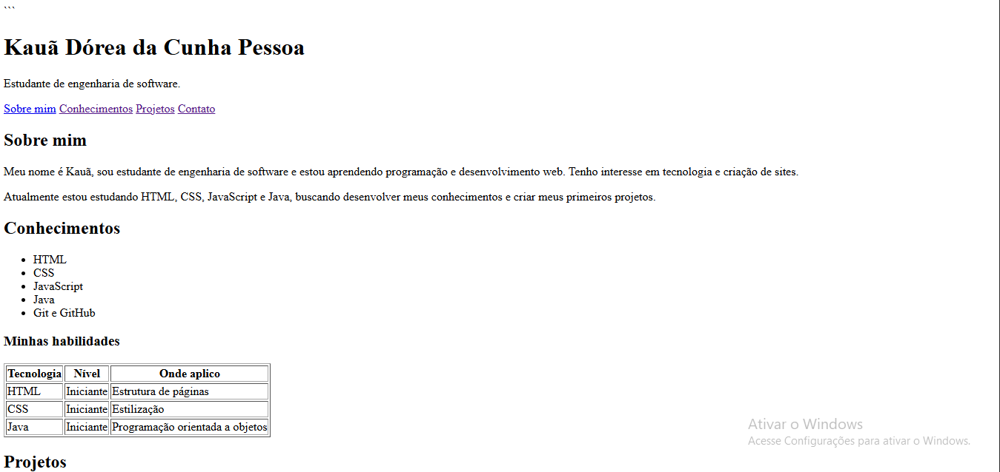
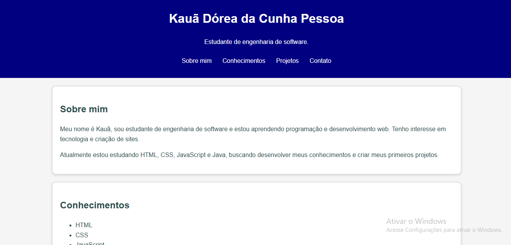

# Evidências de antes e depois

As imagens mostram a mudança visual realizada no meu portfólio.

## Antes

A página apresentava apenas a estrutura básica do HTML, sem a estilização do CSS.

## Depois

Após a aplicação do CSS, o site passou a ter cores, espaçamentos, cartões e uma aparência mais organizada.

